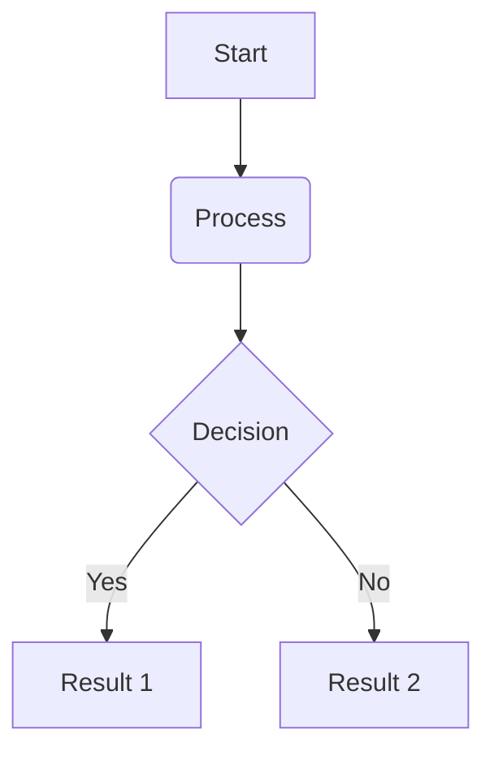
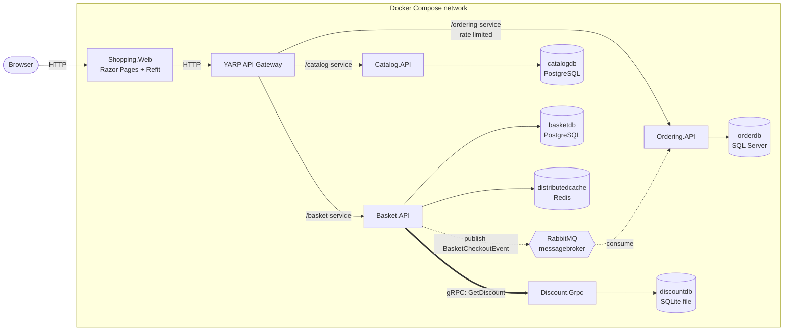
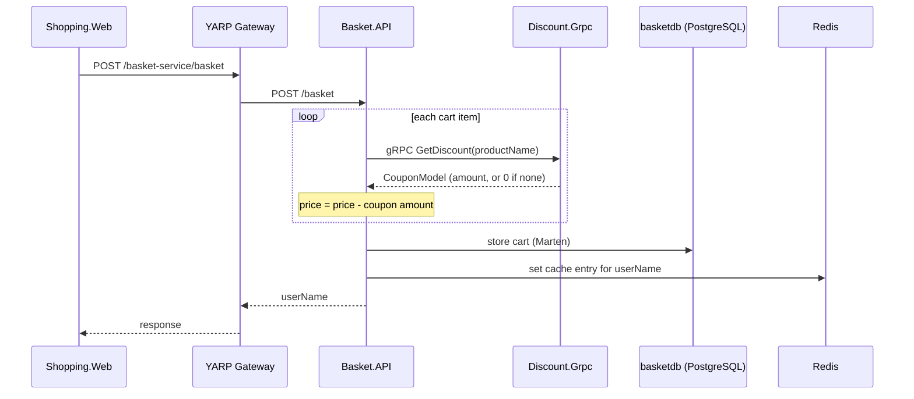
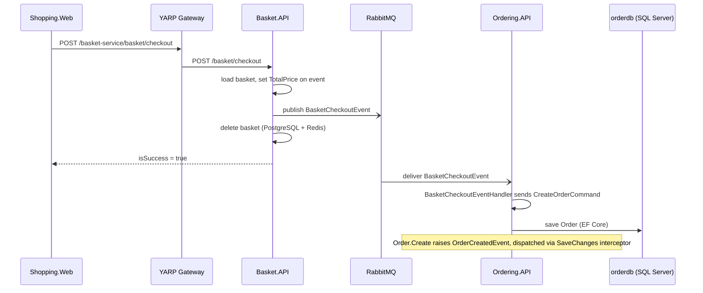

# EShop — Microservices E-Commerce Backend

[](https://dotnet.microsoft.com/)
[](https://learn.microsoft.com/dotnet/csharp/)
[](https://www.postgresql.org/)
[](https://www.microsoft.com/sql-server)
[](https://redis.io/)
[](https://www.rabbitmq.com/)
[](https://www.docker.com/)

A .NET 8 microservices backend for an e-commerce domain: **Catalog**, **Basket**, **Discount** and **Ordering** services behind a **YARP** API gateway, with a Razor Pages shopping UI. The services use different architectural styles and data stores on purpose, and talk to each other over HTTP, gRPC and RabbitMQ.

> **Project status.** This is a **self-study portfolio project** built while following [Mehmet Ozkaya's .NET microservices course](https://www.udemy.com/course/microservices-architecture-and-implementation-on-dotnet/). It is not an independently designed system and has never been deployed to production. Its value is in showing how these patterns fit together in a working, containerised codebase. See [Acknowledgments](#acknowledgments-and-license) and [Known limitations](#known-limitations).

## Table of Contents

- [Overview](#overview)
- [Architecture](#architecture)
- [Microservices](#microservices)
- [Technology Stack](#technology-stack)
- [Key Engineering Concepts](#key-engineering-concepts)
- [Communication and Data Flow](#communication-and-data-flow)
- [Repository Structure](#repository-structure)
- [Prerequisites](#prerequisites)
- [Configuration](#configuration)
- [Run Locally with Docker Compose](#run-locally-with-docker-compose)
- [API Reference and Examples](#api-reference-and-examples)
- [Testing and Troubleshooting](#testing-and-troubleshooting)
- [Design Decisions and Trade-offs](#design-decisions-and-trade-offs)
- [Known limitations](#known-limitations)
- [Learning Outcomes](#learning-outcomes)
- [Future Improvements](#future-improvements)
- [Acknowledgments and License](#acknowledgments-and-license)

## Overview

The system models a small online shop:

| Service | Responsibility | Style | Persistence |
|---|---|---|---|
| **Catalog** | Product listing, lookup by id/category, product CRUD | Minimal APIs (Carter), Vertical Slice, CQRS | PostgreSQL via Marten (document store) |
| **Basket** | Per-user shopping cart, discount application, checkout | Minimal APIs (Carter), Vertical Slice, CQRS | PostgreSQL via Marten, fronted by a Redis cache |
| **Discount** | Coupon lookup and CRUD for product discounts | gRPC server | SQLite via EF Core |
| **Ordering** | Order creation from checkout events, order queries and updates | DDD, Clean Architecture, CQRS | SQL Server via EF Core |
| **YARP Gateway** | Single HTTP entry point for the UI | Reverse proxy | none |
| **Shopping.Web** | Customer-facing UI | Razor Pages + Refit clients | none |

**Synchronous vs asynchronous communication.** The UI reaches Catalog, Basket and Ordering over HTTP through the gateway. When a basket is stored, Basket calls Discount over **gRPC** because it needs the answer immediately to price the cart. At checkout, Basket instead publishes a `BasketCheckoutEvent` to **RabbitMQ** through MassTransit and does not wait for Ordering, which consumes the event and creates the order on its own schedule. Request/response where the caller needs the result, events where it does not.

## Architecture



**Legend**

| Arrow | Meaning |
|---|---|
| `-->` solid | Synchronous HTTP, or a service reading/writing its own datastore |
| `==>` thick | Synchronous gRPC call (HTTP/2 + Protocol Buffers) |
| `-.->` dotted | Asynchronous event via RabbitMQ and MassTransit |

Details that matter when reading the diagram:

- Only **Catalog, Basket and Ordering** are routed by the gateway (see [`appsettings.json`](src/ApiGateways/YarpApiGateway/appsettings.json)). **Discount is internal**: it is reachable only from Basket over gRPC, and Basket and Ordering reach RabbitMQ directly, not through the gateway.
- Each service owns its datastore; none reads another service's database.
- The SQLite database for Discount lives inside the Discount container (see [Known limitations](#known-limitations)).

## Microservices

### Catalog

Source: [`src/Services/Catalog/Catalog.API`](src/Services/Catalog/Catalog.API)

- **Organisation:** Vertical Slice. Each feature folder (`Products/CreateProduct`, `GetProducts`, and so on) holds its endpoint, command/query, handler and validator together.
- **Libraries:** Carter (endpoints), MediatR (CQRS), FluentValidation, Marten (PostgreSQL document store), Mapster.
- **Endpoints:** `GET /products` (paged), `GET /products/{id}`, `GET /products/category/{category}`, `POST /products`, `PUT /products`, `DELETE /products/{id}`.
- **Persistence:** products are stored as Marten documents in PostgreSQL. In the Development environment the service seeds a set of products on startup (`CatalogInitialData`) if none exist.
- **Cross-cutting:** MediatR pipeline behaviours for validation and logging, a global exception handler, and a `/health` endpoint with a PostgreSQL check.

### Basket

Source: [`src/Services/Basket/Basket.API`](src/Services/Basket/Basket.API)

- **Organisation:** Vertical Slice with CQRS, same layout as Catalog.
- **Endpoints:** `GET /basket/{userName}`, `POST /basket`, `DELETE /basket/{userName}`, `POST /basket/checkout`.
- **Persistence:** carts are Marten documents in PostgreSQL, keyed by `UserName`.
- **Caching:** `CachedBasketRepository` decorates `BasketRepository` using Scrutor's `Decorate`, backed by `IDistributedCache` on Redis. Reads check Redis first and fall back to PostgreSQL, populating the cache on a miss. Stores write to PostgreSQL then update the cache. Deletes remove the key from Redis. No expiry is configured on cache entries.
- **Discount (gRPC):** `StoreBasket` calls `DiscountProtoService.GetDiscount` for each cart item and subtracts the returned coupon amount from the item's price before saving.
- **Checkout:** `CheckoutBasket` loads the basket, maps the checkout DTO to a `BasketCheckoutEvent`, sets `TotalPrice` from the basket, publishes it through MassTransit, then deletes the basket.
- **Health:** `/health` checks both PostgreSQL and Redis.

### Discount

Source: [`src/Services/Discount/Discount.Grpc`](src/Services/Discount/Discount.Grpc)

- **Interface:** [`discount.proto`](src/Services/Discount/Discount.Grpc/Protos/discount.proto) defines `DiscountProtoService` with `GetDiscount`, `CreateDiscount`, `UpdateDiscount` and `DeleteDiscount`.
- **Persistence:** SQLite through EF Core. Migrations are applied at startup, and two coupons (IPhone X and Samsung 10) are seeded through `HasData`.
- **Behaviour:** `GetDiscount` looks a coupon up by product name. If none exists it returns a zero-amount placeholder coupon rather than an error, so Basket can treat "no discount" and "discount of 0" the same way.
- **Clients:** Basket generates a gRPC client from the same `.proto` file (`GrpcServices="Client"`), so the contract lives in one place.

### Ordering

Source: [`src/Services/Ordering`](src/Services/Ordering) (four projects)

| Project | Role |
|---|---|
| `Ordering.Domain` | Aggregates, entities, value objects, domain events. No infrastructure dependencies |
| `Ordering.Application` | CQRS commands/queries, MediatR handlers, validators, DTOs, integration event consumer |
| `Ordering.Infrastructure` | EF Core `DbContext`, entity configurations, SQL Server, interceptors, migrations, seed data |
| `Ordering.API` | Carter endpoints, composition root, health check |

- **Domain model:** `Order` is an aggregate root (`Aggregate<OrderId>`) containing `OrderItem`s. Strongly typed value objects include `OrderId`, `CustomerId`, `ProductId`, `OrderName`, `Address` and `Payment`.
- **Endpoints:** `GET /orders` (paged), `GET /orders/{orderName}`, `GET /orders/customer/{customerId}`, `POST /orders`, `PUT /orders`, `DELETE /orders/{id}`.
- **Domain events:** `Order.Create` and `Order.Update` raise domain events that a `DispatchDomainEventsInterceptor` publishes through MediatR on `SaveChanges`. An `AuditableEntityInterceptor` handles audit fields.
- **Messaging:** `BasketCheckoutEventHandler` is a MassTransit consumer of `BasketCheckoutEvent` that sends a `CreateOrderCommand`.
- **Feature flag:** `OrderCreatedEventHandler` publishes an integration event only if the `OrderFullfilment` feature flag is on. Docker Compose sets it to `false`, and no consumer for that event exists in this repository.
- **Persistence:** SQL Server via EF Core. In Development the service applies migrations and seeds sample data on startup.
- **Health:** `/health` with a SQL Server check.

### API Gateway (YARP)

Source: [`src/ApiGateways/YarpApiGateway`](src/ApiGateways/YarpApiGateway)

Routes are defined in configuration. Each prefix is stripped before forwarding:

| Gateway path | Cluster destination (inside Compose) |
|---|---|
| `/catalog-service/{**catch-all}` | `http://catalog.api:8080` |
| `/basket-service/{**catch-all}` | `http://basket.api:8080` |
| `/ordering-service/{**catch-all}` | `http://ordering.api:8080` |

A fixed-window rate limiter (5 requests per 10 seconds) is applied to the **ordering route only**.

### Shopping Web UI

Source: [`src/WebApps/Shopping.Web`](src/WebApps/Shopping.Web)

An ASP.NET Core **Razor Pages** app (home, product list/detail, cart, checkout, confirmation, order list). It calls the backend through **Refit** typed clients (`ICatalogService`, `IBasketService`, `IOrderingService`) registered with `IHttpClientFactory`, all targeting the gateway address from `ApiSettings:GatewayAddress`. The cart uses a fixed demo user name (`swn`); there is no authentication.

### Shared building blocks

- [`BuildingBlocks`](src/BuildingBlocks/BuildingBlocks): CQRS interfaces, MediatR `ValidationBehavior` and `LoggingBehavior`, custom exceptions plus a global exception handler, pagination types.
- [`BuildingBlocks.Messaging`](src/BuildingBlocks/BuildingBlocks.Messaging): integration event contracts (`BasketCheckoutEvent`) and the MassTransit/RabbitMQ registration extension (`AddMessageBroker`).

## Technology Stack

| Category | Technology | Role in this project |
|---|---|---|
| Language/runtime | C# 12, .NET 8 | All services and the web app target `net8.0` |
| API | ASP.NET Core, Minimal APIs, Carter | Endpoint definitions in Catalog, Basket and Ordering |
| Architecture | MediatR, FluentValidation, Mapster | CQRS dispatch, request validation in a pipeline behaviour, object mapping |
| Persistence | Marten + PostgreSQL | Document storage for Catalog and Basket |
| Persistence | Entity Framework Core + SQL Server | Relational model for Ordering |
| Persistence | Entity Framework Core + SQLite | Coupon storage for Discount |
| Caching | Redis (`IDistributedCache`), Scrutor | Basket cache implemented as a decorator |
| Sync communication | gRPC, Protocol Buffers | Basket → Discount |
| Async messaging | RabbitMQ, MassTransit | Checkout event from Basket to Ordering |
| Gateway | YARP | Routing and rate limiting |
| UI client | Refit, `IHttpClientFactory` | Typed HTTP clients in Shopping.Web |
| Ops | ASP.NET Core health checks, Microsoft.FeatureManagement | `/health` endpoints, Ordering fulfilment flag |
| Containers | Docker, Docker Compose | Local orchestration of services and infrastructure |

## Key Engineering Concepts

- **Service-owned data.** Catalog and Basket use PostgreSQL, Ordering uses SQL Server, Discount uses SQLite. The choice follows each service's data shape: documents for catalog/cart, relational for orders.
- **CQRS with MediatR.** Commands and queries are separate types (`ICommand<T>`, `IQuery<T>`), handled by dedicated handlers. Cross-cutting concerns (validation, logging) run as pipeline behaviours, so handlers contain business logic only.
- **Vertical Slice vs Clean Architecture.** Catalog and Basket organise code by feature. Ordering uses layered Clean Architecture with the domain at the centre and dependencies pointing inward. The repository shows both so they can be compared directly.
- **Domain-Driven Design in Ordering.** Aggregate root, value objects with their own validation, private setters and factory methods (`Order.Create`), and domain events dispatched from EF Core interceptors.
- **Decorator-based caching.** `CachedBasketRepository` wraps the real repository, so the handlers do not know a cache exists. Registration uses Scrutor.
- **gRPC vs messaging.** gRPC is used where Basket needs an immediate answer; RabbitMQ is used where Ordering can process the checkout independently of the caller.
- **Gateway routing.** YARP's config-driven routes, path transforms and a per-route rate limiter.
- **Operational basics.** Global exception handling, validation errors surfaced consistently, health checks on data stores, configuration through environment variables.

## Communication and Data Flow

### Flow 1: Storing a basket (pricing)



Reads (`GET /basket/{userName}`) check Redis first and only query PostgreSQL on a cache miss.

### Flow 2: Checkout



The checkout response returns as soon as the event is published. Order creation happens afterwards, which is why a freshly checked-out order may take a moment to show up in the order list.

## Repository Structure

```text
.
├── LICENSE
├── README.md
└── src
    ├── eshop-microservices.sln
    ├── docker-compose.yml              # service and infrastructure definitions (images, builds)
    ├── docker-compose.override.yml     # dev configuration: ports, env vars, connection strings
    ├── docker-compose.dcproj           # Visual Studio Docker Compose project
    ├── ApiGateways
    │   └── YarpApiGateway              # YARP reverse proxy, rate limiter
    ├── BuildingBlocks
    │   ├── BuildingBlocks              # CQRS interfaces, behaviours, exceptions, pagination
    │   └── BuildingBlocks.Messaging    # integration events, MassTransit setup
    ├── Services
    │   ├── Catalog
    │   │   └── Catalog.API             # Minimal APIs + Marten (PostgreSQL)
    │   ├── Basket
    │   │   └── Basket.API              # Minimal APIs + Marten, Redis cache, gRPC client, publisher
    │   ├── Discount
    │   │   └── Discount.Grpc           # gRPC server + SQLite (EF Core)
    │   └── Ordering
    │       ├── Ordering.API            # endpoints, composition root
    │       ├── Ordering.Application    # CQRS handlers, consumers
    │       ├── Ordering.Domain         # aggregates, value objects, domain events
    │       └── Ordering.Infrastructure # EF Core, SQL Server, migrations
    └── WebApps
        └── Shopping.Web                # Razor Pages UI + Refit clients
```

## Prerequisites

| Tool | Notes | Check |
|---|---|---|
| Git | to clone the repository | `git --version` |
| Docker Desktop, or Docker Engine with the Compose plugin | runs all services and infrastructure | `docker --version` and `docker compose version` |
| .NET 8 SDK | only needed to build or run outside Docker | `dotnet --version` |

Allow Docker a few GB of RAM: the stack runs three database engines, Redis, RabbitMQ and six .NET containers (SQL Server alone is memory-hungry).

## Configuration

Configuration is supplied through environment variables in [`src/docker-compose.override.yml`](src/docker-compose.override.yml), which Compose merges automatically with `docker-compose.yml`. ASP.NET Core maps `__` in a variable name to `:` in configuration (`ConnectionStrings__Database` becomes `ConnectionStrings:Database`).

| Setting | Used by | Purpose |
|---|---|---|
| `ConnectionStrings__Database` | Catalog, Basket, Ordering, Discount | PostgreSQL (Catalog, Basket), SQL Server (Ordering), SQLite file (Discount) |
| `ConnectionStrings__Redis` | Basket | Redis endpoint, `distributedcache:6379` |
| `GrpcSettings__DiscountUrl` | Basket | Discount gRPC address, `https://discount.grpc:8081` |
| `MessageBroker__Host` / `__UserName` / `__Password` | Basket, Ordering | RabbitMQ connection |
| `FeatureManagement__OrderFullfilment` | Ordering | Enables publishing an order-created integration event (set to `false`) |
| `ApiSettings__GatewayAddress` | Shopping.Web | Gateway base URL, `http://yarpapigateway:8080` |
| `ASPNETCORE_HTTP_PORTS` / `ASPNETCORE_HTTPS_PORTS` | all web services | Container ports 8080 / 8081 |

**Host ports** (from the override file):

| Component | Host port(s) |
|---|---|
| Shopping.Web | 6005 (HTTP), 6065 (HTTPS) |
| YARP gateway | 6004, 6064 |
| Catalog / Basket / Discount / Ordering | 6000 / 6001 / 6002 / 6003 (HTTP), 6060 to 6063 (HTTPS) |
| PostgreSQL (catalog / basket) | 5432 / 5433 |
| SQL Server | 1433 |
| Redis | 6379 |
| RabbitMQ (AMQP / management UI) | 5672 / 15672 |

**Credentials.** The override file contains throwaway, development-only credentials for PostgreSQL, SQL Server and RabbitMQ so the stack starts without setup. These are for local use only. If you publish or share an environment, replace them, and don't reuse them anywhere real. A safer pattern is to move them into an untracked `.env` file referenced as `${VARIABLE}` placeholders in the override file. Never commit a `.env` file containing real secrets.

**Placeholder example** for supplying your own values:

```yaml
# docker-compose.override.yml (excerpt)
orderdb:
  environment:
    - ACCEPT_EULA=Y
    - SA_PASSWORD=${ORDERDB_SA_PASSWORD}   # defined in your local, git-ignored .env
```

## Run Locally with Docker Compose

> The commands below are derived from the compose files. Compose files in this repository were written for **Visual Studio on Windows** (they mount `${APPDATA}` for user secrets and HTTPS certificates). See [Troubleshooting](#troubleshooting) if you are on macOS or Linux.

1. **Clone and enter the compose directory**

   ```bash
   git clone <your-repository-url>
   cd <repository-folder>/src
   ```

2. **Start Docker** (Docker Desktop, or the Docker daemon).

3. **(Optional) supply your own secrets** as described in [Configuration](#configuration).

4. **Build and start everything**

   ```bash
   docker compose up -d --build
   ```

   Compose automatically merges `docker-compose.yml` with `docker-compose.override.yml`. To be explicit:
   `docker compose -f docker-compose.yml -f docker-compose.override.yml up -d --build`

5. **Check status and logs**

   ```bash
   docker compose ps
   docker compose logs -f basket.api ordering.api
   ```

6. **Wait for dependencies.** The compose file declares `depends_on` for start order only; it has no health-based waiting. SQL Server takes the longest to accept connections. If a service exits early because a database wasn't ready, run `docker compose up -d` again.

7. **Open the UI** at <http://localhost:6005>.

8. **Try a flow:** browse products, add one to the cart, check out, then open the order list. You can also watch the message pass through RabbitMQ at <http://localhost:15672> (management UI; log in with the credentials set in the override file).

9. **Stop and clean up**

   ```bash
   docker compose down        # stop and remove containers, keep volumes
   docker compose down -v     # also delete named volumes (catalog and basket PostgreSQL data)
   ```

   `down -v` permanently deletes the Catalog and Basket databases. SQL Server and the Discount SQLite file have no named volume, so their data is lost whenever their containers are removed.

## API Reference and Examples

All examples go through the gateway at `http://localhost:6004`. No authentication is implemented, and no Swagger/OpenAPI UI is configured. Response shapes are defined by the `*Response` records next to each endpoint.

### Catalog (`/catalog-service`)

| Method | Route | Purpose |
|---|---|---|
| GET | `/products?pageNumber=1&pageSize=10` | List products (paged) |
| GET | `/products/{id}` | Get one product |
| GET | `/products/category/{category}` | Products in a category |
| POST | `/products` | Create a product |
| PUT | `/products` | Update a product |
| DELETE | `/products/{id}` | Delete a product |

```bash
curl "http://localhost:6004/catalog-service/products?pageNumber=1&pageSize=10"

curl -X POST http://localhost:6004/catalog-service/products \
  -H "Content-Type: application/json" \
  -d '{"name":"Test Phone","category":["Smart Phone"],"description":"Demo item","imageFile":"product-1.png","price":500}'
```

Validation requires a name, category, image file and a price above zero.

### Basket (`/basket-service`)

| Method | Route | Purpose |
|---|---|---|
| GET | `/basket/{userName}` | Get a user's basket (404 if none) |
| POST | `/basket` | Store a basket; applies Discount amounts |
| DELETE | `/basket/{userName}` | Delete a basket |
| POST | `/basket/checkout` | Publish a checkout event |

```bash
curl -X POST http://localhost:6004/basket-service/basket \
  -H "Content-Type: application/json" \
  -d '{"cart":{"userName":"swn","items":[{"quantity":1,"color":"Black","price":950,"productId":"5334c996-8457-4cf0-815c-ed2b77c4ff61","productName":"IPhone X"}]}}'

curl http://localhost:6004/basket-service/basket/swn
```

With the seeded coupon for "IPhone X", the stored price is reduced by the coupon amount.

```bash
curl -X POST http://localhost:6004/basket-service/basket/checkout \
  -H "Content-Type: application/json" \
  -d '{"basketCheckoutDto":{"userName":"swn","customerId":"58c49479-ec65-4de2-86e7-033c546291aa","totalPrice":0,"firstName":"Jane","lastName":"Doe","emailAddress":"jane@example.com","addressLine":"1 Test Street","country":"Egypt","state":"Cairo","zipCode":"00000","cardName":"Test","cardNumber":"0000000000000000","expiration":"12/30","cvv":"000","paymentMethod":1}}'
```

Use dummy payment values only. The checkout call requires an existing basket for `userName`.

### Ordering (`/ordering-service`, rate limited)

| Method | Route | Purpose |
|---|---|---|
| GET | `/orders?pageIndex=1&pageSize=10` | List orders (paged) |
| GET | `/orders/{orderName}` | Orders by name |
| GET | `/orders/customer/{customerId}` | Orders for a customer |
| POST | `/orders` | Create an order |
| PUT | `/orders` | Update an order |
| DELETE | `/orders/{id}` | Delete an order |

```bash
curl "http://localhost:6004/ordering-service/orders?pageIndex=1&pageSize=10"
```

Requests above the gateway's limit of 5 per 10 seconds on this route are rejected.

### Health checks

Catalog, Basket and Ordering expose `/health` directly on their own host ports (for example <http://localhost:6000/health>). They are not routed through the gateway.

### Discount (gRPC)

`DiscountProtoService` is not reachable over plain HTTP. Use a gRPC client such as `grpcurl` against `localhost:6062` (TLS) with the contract in [`discount.proto`](src/Services/Discount/Discount.Grpc/Protos/discount.proto); server reflection isn't enabled, so pass the proto file explicitly.

## Testing and Troubleshooting

### Testing

There are **no automated test projects** and **no CI workflow** in this repository, so no coverage is implied. Manual verification:

1. `docker compose ps` shows all containers running.
2. `GET /health` on Catalog, Basket and Ordering reports healthy.
3. Product list loads in the UI (Catalog + PostgreSQL + seed data).
4. Store a basket and confirm the price was reduced for a product with a coupon (Basket → Discount gRPC).
5. Check out and confirm a `basket-checkout-event` queue/exchange activity in the RabbitMQ UI, then see the order appear (Ordering consumer + SQL Server).

### Troubleshooting

**Project-specific (derived from the compose and code):**

- **No gateway route to Discount.** That's intentional. Test it via Basket, or call gRPC directly on port 6062.
- **Basket → Discount fails.** Basket calls `https://discount.grpc:8081` and (in code) accepts any server certificate, but Discount still needs an HTTPS endpoint on 8081. The compose file mounts ASP.NET HTTPS certs from `${APPDATA}`; if no dev certificate is available, the Discount container may fail to bind HTTPS.
- **`${APPDATA}` warnings or mount errors on macOS/Linux.** The volume lines for UserSecrets and HTTPS assume Windows. Either set `APPDATA` to a directory you control, or remove those mounts in a local, uncommitted override.
- **Ordering or Basket crash-loop at startup.** Usually a dependency (SQL Server, RabbitMQ, PostgreSQL) wasn't ready yet; `depends_on` doesn't wait for readiness. Re-run `docker compose up -d`.
- **Checkout succeeds but the order has unexpected items.** See [Known limitations](#known-limitations).

**General:**

- *Port already in use:* change the left-hand side of the port mapping in the override file, or stop the conflicting local service (especially 5432, 1433, 6379, 5672).
- *SQL Server won't start:* check `docker compose logs orderdb`; it needs enough memory and a password that meets SQL Server's complexity rules.
- *Redis or RabbitMQ unreachable:* inside Compose use the service hostnames (`distributedcache`, `ecommerce-mq`), not `localhost`.

## Design Decisions and Trade-offs

- **gRPC for Discount.** A strongly typed contract shared via a `.proto` file and a low-overhead binary protocol suit a fast internal lookup. The cost: Basket now depends on Discount being available to store a basket, and no retry or fallback policy exists.
- **RabbitMQ for checkout.** Decoupling Basket from Ordering means a slow or down Ordering service doesn't block checkout. The cost: eventual consistency, and no outbox, so a crash between publish and basket deletion could leave them out of step.
- **Redis via decorator.** Keeping caching out of handlers is easy to test and swap. Cache entries have no expiry, so staleness is controlled only by write-through and delete.
- **Mixed persistence.** Document storage fits carts and products; relational storage fits order aggregates. It also means three database engines to run and operate.
- **YARP gateway.** Config-driven routing gives the UI one address and enables per-route policies like the Ordering rate limit. The gateway currently has no authentication.
- **CQRS and layered Ordering.** More files and indirection than a simple CRUD service, in exchange for isolating the domain model and keeping handlers small. Catalog and Basket skip that ceremony with Vertical Slices.

No performance claims are made; the project has no benchmarks.

## Known limitations

These come from reading the code and are worth knowing before reusing any of it:

- **Ordering builds order items from placeholders.** `BasketCheckoutEventHandler` creates the order with two hard-coded order items rather than the basket's real contents (the checkout event carries no line items). This is a course simplification.
- **Discount is deducted whenever a basket is stored**, without tracking whether it was already applied, so storing an already-discounted cart would discount it again.
- **Payment details** (card number, CVV) travel in the checkout event and are mapped into the order. Fine for a demo with dummy data; not acceptable for real payments.
- **Discount's SQLite file has no volume**, so coupon data resets when the container is recreated (the seeded coupons are restored by migrations).
- **No authentication or authorization**; the UI uses a fixed demo user.
- **Compose is Visual Studio/Windows oriented** (`${APPDATA}` mounts, dev certificates).
- **No automated tests or CI.**

## Learning Outcomes

Working through this project covered:

- Decomposing a system into services with their own data stores.
- CQRS with MediatR pipeline behaviours; Vertical Slice versus Clean Architecture on the same domain.
- Tactical DDD: aggregates, value objects and domain events dispatched through EF Core interceptors.
- gRPC contract design and client generation; event-driven messaging with MassTransit and RabbitMQ.
- Cache-aside style caching through the decorator pattern with Redis.
- API gateway routing and rate limiting with YARP; typed HTTP clients with Refit.
- Orchestrating a multi-container stack with Docker Compose and debugging environment issues.

The architecture and code come from the course; the learning is in understanding, running and debugging how the pieces interact.

## Future Improvements

Not implemented today, and realistic next steps:

- Automated unit and integration tests (for example Testcontainers for PostgreSQL, SQL Server and RabbitMQ) and a CI workflow.
- Authentication and authorization at the gateway (JWT / OpenID Connect).
- Build the order from real basket items; carry line items in `BasketCheckoutEvent`.
- Resilience: retries and circuit breakers for the gRPC call, MassTransit retry/outbox for messaging.
- Observability: structured logging sink, metrics and distributed tracing (OpenTelemetry).
- Health-based `depends_on` conditions in Compose, and cache expiry policies for Redis.
- Remove payment data from events and persistence.

## Acknowledgments and License

This project follows the course **[Microservices Architecture and Implementation on .NET](https://www.udemy.com/course/microservices-architecture-and-implementation-on-dotnet/)** by **Mehmet Ozkaya**. The original source repository is [mehmetozkaya/EShopMicroservices](https://github.com/mehmetozkaya/EShopMicroservices), and the author's article [.NET 8 Microservices: DDD, CQRS, Vertical/Clean Architecture and Event-Driven Communication](https://medium.com/@mehmetozkaya/net-8-microservices-ddd-cqrs-vertical-clean-architecture-2dd7ebaaf4bd) explains the design. Credit for the architecture and original implementation belongs to him.

Released under the MIT License; see [`LICENSE`](LICENSE). The original repository is MIT licensed, copyright (c) 2024 Mehmet Ozkaya, and that notice must be retained in derivative copies.
